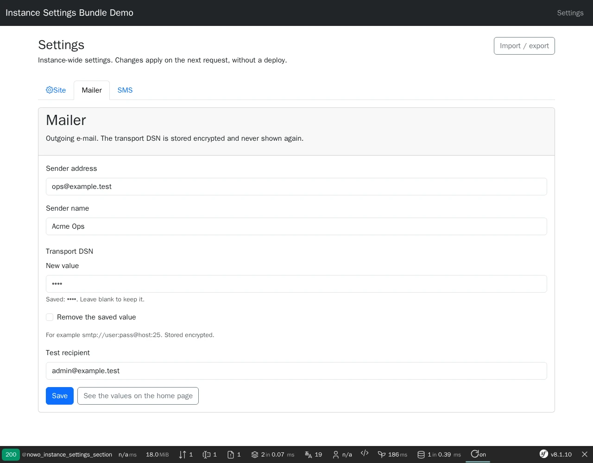
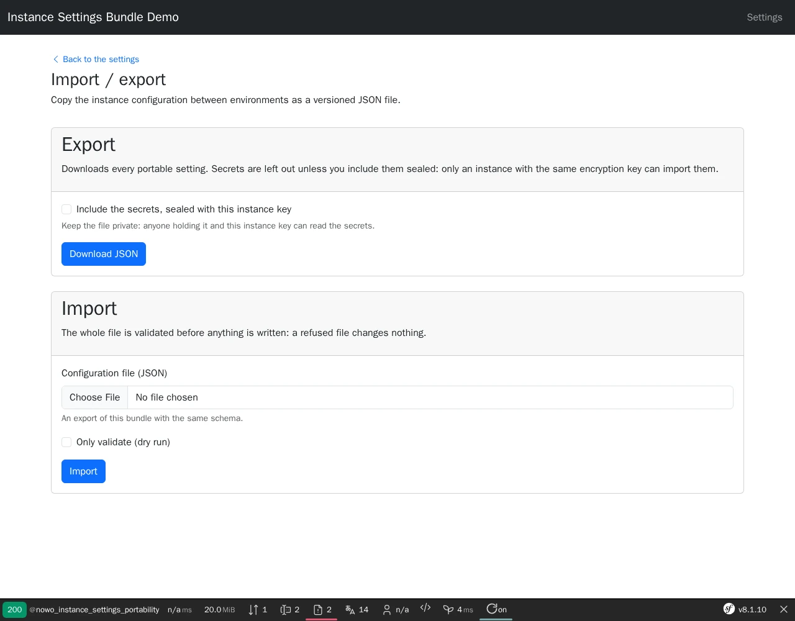

# Instance Settings Bundle

[](https://github.com/nowo-tech/InstanceSettingsBundle/actions/workflows/ci.yml) [](https://packagist.org/packages/nowo-tech/instance-settings-bundle) [](https://packagist.org/packages/nowo-tech/instance-settings-bundle) [](LICENSE) [](https://php.net) [](https://symfony.com) [](https://github.com/nowo-tech/InstanceSettingsBundle) [](#tests-and-coverage)

> ⭐ **Found this useful?** [Install from Packagist](https://packagist.org/packages/nowo-tech/instance-settings-bundle) · Give it a **star** on [GitHub](https://github.com/nowo-tech/InstanceSettingsBundle) so more developers can find it.

**Instance Settings Bundle** — runtime settings an operator edits without a deploy: one database-backed store split into **sections** that the host and other bundles contribute (mailer, SMS provider, Mercure hub, feature flags…), typed getters with defaults, **secret fields encrypted at rest** with [DoctrineEncryptBundle](https://github.com/nowo-tech/DoctrineEncryptBundle), a UiKit admin UI (one page per section, FormKit forms, CSRF, roles), and a versioned **JSON export / import** (web page and CLI) with secrets left out or sealed with the instance key. Tested on Symfony **7.4**, **8.0** and **8.1** · PHP 8.2+ (Symfony 8.x requires PHP 8.4+).


This bundle is **FrankenPHP worker mode friendly**.

Reads cost one query per request and are memoized for the current main request only, so a saved change applies on the next request in every worker, also when the kernel is not reset between requests. See [docs/FRANKENPHP-WORKER-AUDIT.md](docs/FRANKENPHP-WORKER-AUDIT.md).

## Screenshots

<table>
  <tr>
    <td align="center" width="50%">
      
      <br /><sub>One tab per section; the encrypted DSN is never rendered back</sub>
    </td>
    <td align="center" width="50%">
      
      <br /><sub>Versioned export (secrets sealed on request) and all-or-nothing import</sub>
    </td>
  </tr>
</table>

## Features

- **Sections** — implement `SettingsSectionInterface` (or extend `AbstractSettingsSection`) and declare fields with types, defaults, labels, constraints and flags; autoconfigured, ordered by `#[AsSettingsSection(priority:)]`. Bundles such as a mailer or an SMS kit contribute their own section without depending on each other.
- **Typed reads with defaults** — `InstanceSettingsInterface::get('mailer.from')`, `getString()`, `getInt()`, `getFloat()`, `getBool()`, `getSection()`; the stored value, else the field default. Twig: `instance_setting('site.name')`.
- **Encrypted secrets** — `SettingField::secret()` values are stored in an `#[Encrypted]` column (DoctrineEncrypt, Halite / Defuse), read only through `getSecret()`, never rendered back in forms (blank keeps, a checkbox clears), refused by `get()` and by Twig.
- **Worker-safe cache** — every row is loaded with one query on the first read of a request, memoized for that main request, cleared by `kernel.reset` and after each save; `SettingsChangedEvent` (field names only) lets listeners reset their own caches.
- **Validation** — types, required fields, e-mail / http(s) URL / choice checks and your Symfony constraints run on every save and import, all-or-nothing; messages name fields, never values.
- **Admin UI** — UiKit settings scaffold (REQ-UI-003): a tab per section the user may open, FormKit form types, CSRF on every mutation, `security.access_roles` + per-section `security.area_roles` + custom access checker; extra section actions (e.g. "send a test e-mail").
- **Config portability** — versioned JSON envelope (`schema`, `version`, `exported_at`): every portable plain field, secrets only **sealed** with the instance key (only an instance with the same key can import them), tagged `PortabilityProviderInterface` services for data stored elsewhere; size-capped upload reader, credential-shaped keys refused, dry run, single transaction. Admin page plus `nowo:instance-settings:export` / `nowo:instance-settings:import`.
- **Fail-closed wiring** — the container refuses to compile without DoctrineEncrypt, with the UI on but no form CSRF, with an empty role list, or with `allow_unauthenticated` outside `kernel.debug`.
- **Doctrine** — one table `instance_setting_value` with a configurable `doctrine.table_prefix`, attribute mapping, migrations-friendly.

## Installation

```bash
composer require nowo-tech/instance-settings-bundle
```

With Symfony Flex the recipe adds `config/packages/nowo_instance_settings.yaml`, the route import and a `security.yaml` reminder. Without Flex, register `NowoDoctrineEncryptBundle`, `NowoUiKitBundle`, `NowoFormKitBundle` and `NowoInstanceSettingsBundle`, then import the routes — see [docs/INSTALLATION.md](docs/INSTALLATION.md).

```yaml
# config/routes/nowo_instance_settings.yaml
nowo_instance_settings:
    resource: .
    type: nowo_instance_settings
```

Create the table with a migration (`php bin/console doctrine:migrations:diff`), then protect the prefix in your firewall:

```yaml
# config/packages/security.yaml
security:
    access_control:
        - { path: ^/admin/settings, roles: ROLE_ADMIN }
```

## Quick start

```php
use Nowo\InstanceSettingsBundle\Section\AbstractSettingsSection;
use Nowo\InstanceSettingsBundle\Section\SettingField;
use Symfony\Component\Validator\Constraints\Range;

final class SiteSettingsSection extends AbstractSettingsSection
{
    public function getName(): string { return 'site'; }

    public function getFields(): iterable
    {
        yield SettingField::string('name', 'Acme', 'site.name', required: true);
        yield SettingField::int('page_size', 25, 'site.page_size', constraints: [new Range(min: 5, max: 200)]);
        yield SettingField::secret('api_key', 'site.api_key');
    }
}
```

```php
public function __construct(private InstanceSettingsInterface $settings) {}

$name   = $this->settings->getString('site.name');   // 'Acme' until an admin changes it
$size   = $this->settings->getInt('site.page_size');
$apiKey = $this->settings->getSecret('site.api_key'); // decrypted, or null
```

Open `/admin/settings`: one tab per section, the form built from the fields.

## Requirements

- PHP **8.2+** (`>=8.2 <8.6`; Symfony 8.x requires PHP 8.4+)
- Symfony **7.4**, **8.0** or **8.1** (FrameworkBundle, Form, Validator, Security CSRF, TwigBundle; SecurityBundle for the admin UI)
- Doctrine ORM **3.3+** with DoctrineBundle, `nowo-tech/doctrine-encrypt-bundle` **^2.9** (secrets), `nowo-tech/ui-kit-bundle` **^2.17.3** and `nowo-tech/form-kit-bundle` **^2.17** (admin UI), `twig/extra-bundle`

## Configuration

Every key, its default and its validation are documented in [docs/CONFIGURATION.md](docs/CONFIGURATION.md). Safe defaults: UI under `/admin/settings` for `ROLE_ADMIN` only, sealed secrets in exports only when asked for, 1 MiB import cap, no table prefix.

## Usage

Contributing a section (the API a mailer or an SMS bundle builds on), typed getters, reacting to changes, secrets, export / import and portability providers: [docs/USAGE.md](docs/USAGE.md).

## Demo

- `demo/symfony8` — Symfony **8.1** (FrankenPHP PHP **8.5**, worker mode) with MySQL; host port **8079** by default. Sections Site, Mailer (encrypted DSN) and SMS (encrypted token); the home page reads them on every request.

Runtime mode is **`FRANKENPHP_MODE`** (`worker` default, or `classic`) — see [docs/DEMO-FRANKENPHP.md](docs/DEMO-FRANKENPHP.md).

```bash
make -C demo up-symfony8          # http://localhost:8079
make -C demo/symfony8 setup       # encryption key, schema, demo settings
make test-e2e                     # Playwright e2e against the running demo
make demo-screenshots             # refresh docs/images/demo/*.webp
make demo-smoke                   # boot, HTTP 200, down (REQ-TEST-011)
```

## Development

```bash
make up
make install
make test
make cs-check
make phpstan
make igor
make test-coverage-100
make release-check
```

## Documentation

- [Installation](docs/INSTALLATION.md)
- [Configuration](docs/CONFIGURATION.md)
- [Usage](docs/USAGE.md)
- [Contributing](docs/CONTRIBUTING.md)
- [Code of Conduct](CODE_OF_CONDUCT.md)
- [Changelog](docs/CHANGELOG.md)
- [Upgrading](docs/UPGRADING.md)
- [Release](docs/RELEASE.md)
- [Security](docs/SECURITY.md)
- [Engram](docs/ENGRAM.md)
- [Spec-driven development](docs/SPEC-DRIVEN-DEVELOPMENT.md)
- [GitHub Spec Kit](docs/SPEC-KIT.md)

### Additional documentation

- [Templates (UiKit page contract)](docs/TEMPLATES.md)
- [Architecture](docs/ARCHITECTURE.md)
- [PSR evaluation (REQ-CS-007)](docs/PSR.md)
- [Demo (FrankenPHP)](docs/DEMO-FRANKENPHP.md)
- [FrankenPHP worker audit (kernel not reset)](docs/FRANKENPHP-WORKER-AUDIT.md)
- [GitHub Actions CI requirements](docs/GITHUB_CI.md)

## Tests and coverage

- Tests: PHPUnit (PHP) — unit tests plus kernel integration tests (admin UI end to end with SecurityBundle, CSRF, encryption at rest on SQLite, import / export, opt-in routes, invalid configuration) and the UiKit page contract test; Playwright e2e on the demo
- PHP: 100% (1235/1235 statements, 1414/1414 elements; gate enforced in CI by `composer test-coverage-100`, no exclusions)
- TS/JS: N/A
- Python: N/A

## License and author

MIT · [Nowo.tech](https://nowo.tech) · [Héctor Franco Aceituno](https://github.com/HecFranco)
